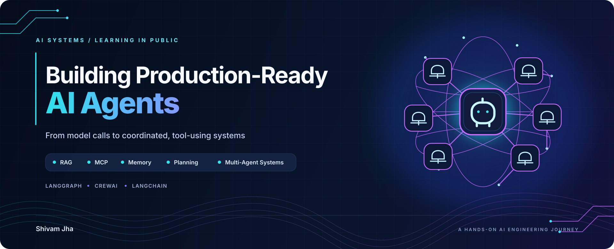

  

# AI-Agent

A hands-on learning project exploring AI agents with Python—from basic interactions with local models to autonomous workflows and multi-agent systems.

## Topics Covered

AI Agents · RAG · MCP · Memory · Planning · Multi-Agent Systems · LangGraph · CrewAI · LangChain

## Learning Goals

- **Agent fundamentals:** Build AI agents from scratch using Python and understand their core architecture.
- **AI assistants:** Add conversation memory, tool usage, document processing, and Retrieval-Augmented Generation (RAG).
- **Autonomous agents:** Explore planning, reasoning, memory, and advanced RAG techniques.
- **Model Context Protocol (MCP):** Connect agents to external tools and data sources.
- **Multi-agent systems:** Orchestrate specialized agents that collaborate on complex tasks.
- **Agent frameworks:** Use LangGraph, CrewAI, and LangChain to build toward production-ready applications.

## Current Progress

- Created a Python virtual environment.
- Added `part01/hello_ai.py` for initial interactions with an Ollama model.
- Configured Git to exclude local environment files and secrets.

The capabilities listed under Learning Goals are the project roadmap and will be added progressively.

## Final Project: AI Research Agent

Build a complete research agent capable of:

- Researching information from multiple sources.
- Verifying findings and identifying inconsistencies.
- Maintaining research notes and context.
- Generating structured research reports.

## Project Structure

    AI-Agent/
    ├── part01/
    │   └── hello_ai.py
    ├── .gitignore
    └── README.md

## Getting Started

1. Install Python and Ollama.
2. Download the Ollama model referenced in `part01/hello_ai.py`.
3. Create and activate a Python virtual environment.
4. Install the dependencies required by the script.
5. Run the script from the project root:

    python part01/hello_ai.py

## Security

Store API keys and other secrets in `.env` files.
Keep `.env` and `.venv` excluded from Git using `.gitignore`.